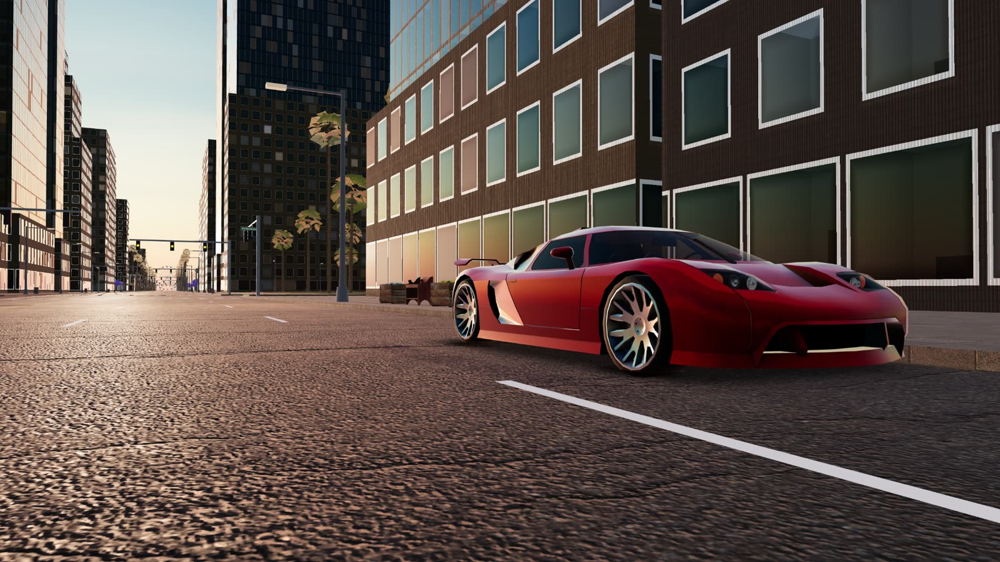
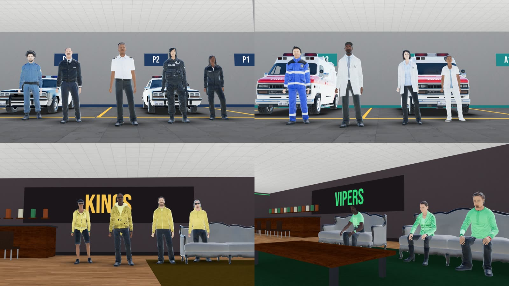
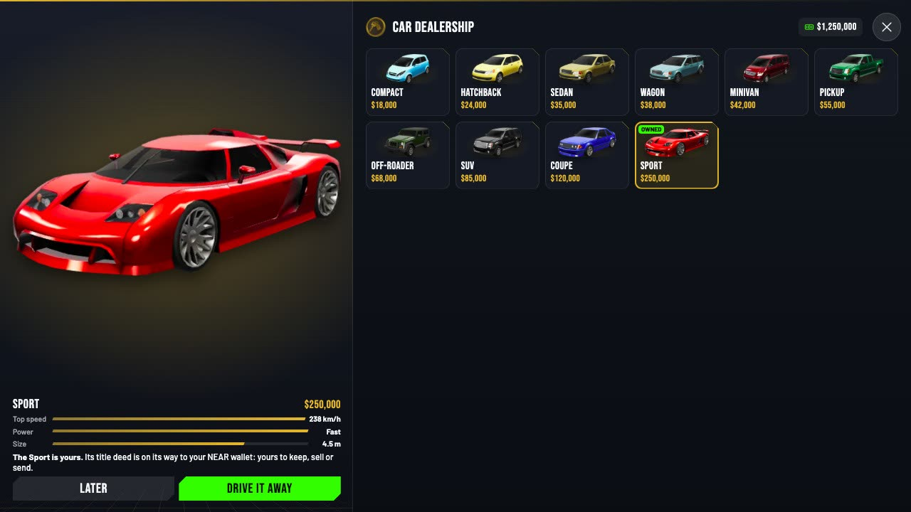
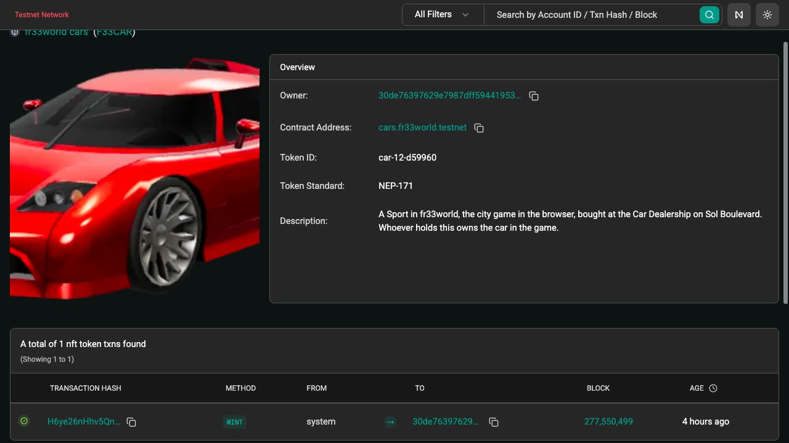
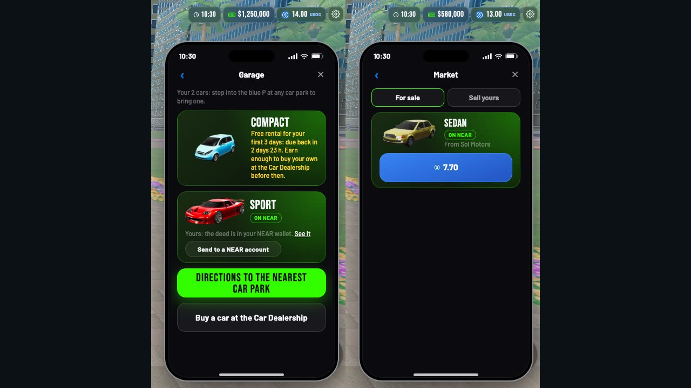
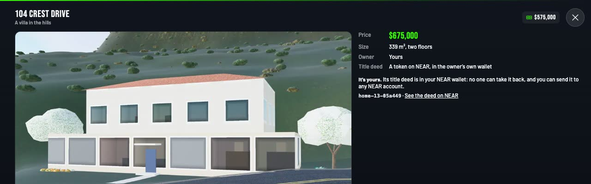
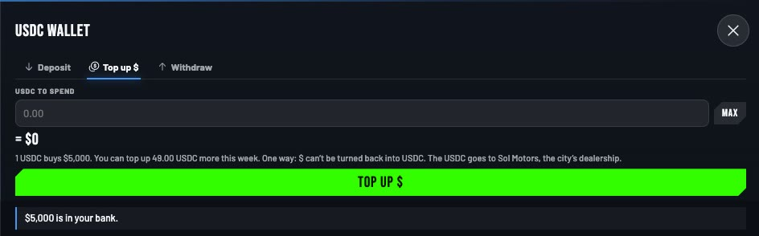
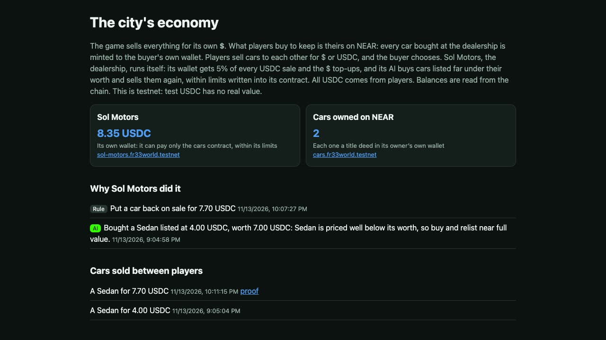

# fr33world

**A multiplayer open-world city game in the browser. The cars and homes players buy are NFTs in their own NEAR wallets, and the car dealership is an AI-run business whose spending is capped by its smart contract.**

Built at NEAR HACKATHON · Tracks: Games With Real Economies, Autonomous Business, Agent Economy, AI Security & Defense

[**Play it**](https://fr33worldgame.xyz) · [**Live economy page**](https://fr33worldgame.xyz/economy.html) · [**Cars on NearBlocks**](https://testnet.nearblocks.io/address/cars.fr33world.testnet) · [**Sol Motors on NearBlocks**](https://testnet.nearblocks.io/address/sol-motors.fr33world.testnet)



## What it is

fr33world is a city life game you play in the browser, on desktop or phone. You walk, drive, work jobs, join the police, the hospital or a gang, and earn the game's money, `$`.

In most city games you own nothing: a ban, a wipe or a shutdown and your garage is gone. In fr33world, every car you buy at the dealership and every villa you buy in the hills is minted to **your own NEAR wallet** as a title deed. You can sell it to other players for `$` or real USDC, send it to any NEAR account, and it stays yours even if the game bans you.

The dealership, **Sol Motors**, runs itself. It has its own wallet and an AI that buys underpriced cars and sells them again, but the AI can only do what its smart contract allows, so a wrong or tricked AI can't drain it.

**The chain stays out of the way.** Players never need NEAR, a seed phrase or a wallet app:

- A NEAR wallet is made for them when they sign in (Privy embedded wallet), and the game pays their gas.
- Everything in the game is priced in `$`. A deed simply shows up in the Garage as "On NEAR", with a link to see it.
- USDC only appears if a player chooses it: to sell a car to another player, or to top up `$`.



## What's on NEAR

### 1. Buy a car, get its deed

Buy a car with `$` at the dealership. Its deed (an NFT on the [cars contract](contracts/cars/src/lib.rs)) is minted to your wallet, and the Garage links to it on NearBlocks.

<table>
  <tr>
    <td width="50%"></td>
    <td width="50%"></td>
  </tr>
  <tr>
    <td>The dealership sells for <code>$</code>. The deed goes to your wallet.</td>
    <td>The same car on NearBlocks, owned by the player's account.</td>
  </tr>
</table>

### 2. Trade with other players for `$` or USDC

The seller asks `$`, USDC or both; the buyer picks. A USDC sale settles in one contract call: the car moves, the seller gets 95% and Sol Motors 5%.



### 3. Own a home

The 36 villas in the hills are bought for `$` at their front door, one owner each, and minted to the buyer's wallet on the homes contract.



### 4. Top up with USDC (one way)

1 USDC buys $5,000, up to 50 USDC a week. There's no way back from `$` to USDC, so the game can't be farmed for money. On testnet, the wallet's **Get test USDC** button asks the public community faucet for you.



### 5. Sol Motors runs itself

All of Sol Motors' USDC comes from players (the 5% cut and top-ups); the game puts in none. When a car is listed far under its worth, its AI may buy it and relist it. Three locks keep that safe:

| Lock                      | What it does                                                                                                                                                                      |
| ------------------------- | --------------------------------------------------------------------------------------------------------------------------------------------------------------------------------- |
| **The AI proposes**       | NEAR AI Cloud picks a car and a resale price. It sees only numbers, never player text, so it can't be prompt-injected.                                                            |
| **Rules clamp**           | [`BUYBACK`](packages/shared/src/assets.ts): only cars at ≤ 60% of worth, at most half the balance, 3 cars held, resale at 90–120% of worth.                                       |
| **The contract enforces** | The [wallet contract](contracts/business-wallet/src/lib.rs) can pay only the cars contract, at most 25 USDC a payment and 100 a day. No withdraw method; a new payee waits a day. |



<sub>Above: the economy page during the recorded demo run. Those trades are real on testnet: Sol Motors bought the Sedan `car-4-b9b3bd` at 4 USDC and relisted it at 7.70 ([see it on NearBlocks](https://testnet.nearblocks.io/address/sol-motors.fr33world.testnet)). The hosted page's lists fill as players trade there.</sub>

## Claims and where to check them

| Claim                                                                       | Code                                                                                    | Proof                                                                                                                                                                                             |
| --------------------------------------------------------------------------- | --------------------------------------------------------------------------------------- | ------------------------------------------------------------------------------------------------------------------------------------------------------------------------------------------------- |
| Cars are NEP-171 tokens minted to the buyer's wallet                        | [contracts/cars](contracts/cars/src/lib.rs)                                             | [`car-12-d59960`](https://testnet.nearblocks.io/nft-token/cars.fr33world.testnet/car-12-d59960) on NearBlocks                                                                                     |
| The game and its admin can't move a player's car                            | [contracts/cars](contracts/cars/src/lib.rs)                                             | `the_minter_cant_move_a_players_car`, `the_admin_cant_move_a_players_car` in [tests.rs](contracts/cars/src/tests.rs)                                                                              |
| A `$` sale moves only a car its owner offered, once                         | [apps/api/src/cars.ts](apps/api/src/cars.ts)                                            | `the_game_hands_an_offered_car_to_its_dollar_buyer` in [tests.rs](contracts/cars/src/tests.rs), [cars.test.ts](apps/api/src/cars.test.ts)                                                         |
| Sol Motors can pay only the cars contract, ≤ 25 USDC a payment, ≤ 100 a day | [contracts/business-wallet](contracts/business-wallet/src/lib.rs)                       | `unapproved_suppliers_are_refused`, `the_payment_limit_holds`, `the_daily_limit_holds`, `the_admin_cannot_pay_either` in [tests.rs](contracts/business-wallet/src/tests.rs); live `summary` below |
| The AI sees only numbers and its answer is clamped to the rules             | [apps/api/src/dealer.ts](apps/api/src/dealer.ts), [advisor.ts](apps/api/src/advisor.ts) | [dealer.test.ts](apps/api/src/dealer.test.ts)                                                                                                                                                     |
| The AI really traded on testnet                                             |                                                                                         | Sol Motors' [`on_order_paid` and `list_car`](https://testnet.nearblocks.io/address/sol-motors.fr33world.testnet) for `car-4-b9b3bd`                                                               |
| Villas are deeds too, one owner each                                        | [apps/api/src/homes.ts](apps/api/src/homes.ts)                                          | [homes.test.ts](apps/api/src/homes.test.ts); [`home-13-05a449`](https://testnet.nearblocks.io/nft-token/homes.fr33world.testnet/home-13-05a449)                                                   |

## Try it in the browser

1. Open [fr33worldgame.xyz](https://fr33worldgame.xyz) and sign in (email, Google, Discord or X). A NEAR wallet is made for you; the game pays its gas.
2. Tap the **USDC** chip at the top, then **Get test USDC** (5 from the public faucet), then **Top up $** with it: 5 USDC buys $25,000.
3. Press **P** (or tap the phone) → **Garage** → **Buy a car at the Car Dealership**, and follow the directions.
4. Buy a car. Back in **Garage**, tap **See it** to open its deed on NearBlocks.

**Controls:** WASD to move, mouse to look, E to get in or out of a car, P for the phone, T to chat. On a phone: joystick on the left, drag on the right to look.

## Run it locally

You need **Node 24+** and **pnpm 11**. For the contracts, **Rust** with [cargo-near](https://github.com/near/cargo-near). For the API tests, **PostgreSQL**.

### Play the city (no accounts, no keys)

```bash
pnpm install
pnpm dev:world      # world server on :7400
pnpm dev:client     # in a second terminal: the game on :5173
```

Open http://localhost:5173. With no `.env`, login is off and you play as a guest. Characters stand in a T-pose locally, because their animation files aren't in this repo (their licence doesn't allow sharing them on their own). The hosted game has them.

### Check the NEAR part

**Contracts.** Plain `cargo test`. **See:** `36 passed` and `31 passed`. They include: the minter and admin can't move a player's car, a `$` sale works only for an offered car and only once, a wrong amount is refunded, and a stolen admin key can't pay itself.

```bash
cd contracts/cars && cargo test
cd ../business-wallet && cargo test
```

**Economy rules** against a stand-in chain. **See:** `Tests  45 passed`. They cover deeds minted once, a home sold to one buyer only, the garage following the chain, both currencies, the handover undone if the chain refuses, the top-up cap, and the AI's answers cut to the rules.

```bash
# with PostgreSQL running (on a Mac with Homebrew's postgresql@18: pnpm db:start)
createdb fr33world_test
pnpm --filter @fr33world/api exec vitest run src/cars.test.ts src/homes.test.ts src/dealer.test.ts src/usdc.test.ts
```

**The live contracts.** Read Sol Motors' wallet straight from testnet. **See:** JSON with `"per_payment":"25000000"`, `"per_day":"100000000"` (25 and 100 USDC, 6 decimals), its `balance`, and `"suppliers":["cars.fr33world.testnet"]`, its only allowed payee.

```bash
curl -s https://test.rpc.fastnear.com -H 'content-type: application/json' -d '{"jsonrpc":"2.0","id":1,"method":"query","params":{"request_type":"call_function","finality":"final","account_id":"sol-motors.fr33world.testnet","method_name":"summary","args_base64":"e30="}}' \
  | node -e 'let s="";process.stdin.on("data",d=>s+=d).on("end",()=>console.log(Buffer.from(JSON.parse(s).result.result).toString()))'
```

**The whole story on chain** (needs testnet keys in `.env`, see [.env.example](.env.example)): `pnpm --filter @fr33world/api economy:live`. Two players buy, list, sell for USDC and `$`, top up, and send a car out of the game, and Sol Motors' AI buys an underpriced Sedan. Every payment prints a NearBlocks link, ending in `All good.`

## Contracts (NEAR testnet)

| Account                                                                                              | What it is                                          |
| ---------------------------------------------------------------------------------------------------- | --------------------------------------------------- |
| [`cars.fr33world.testnet`](https://testnet.nearblocks.io/address/cars.fr33world.testnet)             | Car deeds (NEP-171) and the player-to-player market |
| [`homes.fr33world.testnet`](https://testnet.nearblocks.io/address/homes.fr33world.testnet)           | Villa deeds: the same contract code, deployed again |
| [`sol-motors.fr33world.testnet`](https://testnet.nearblocks.io/address/sol-motors.fr33world.testnet) | Sol Motors' policy wallet                           |
| `usdc.fakes.testnet`                                                                                 | Community test USDC (no value)                      |

## Built with

- **Contracts:** Rust, [near-sdk](https://crates.io/crates/near-sdk) 5.30 and near-contract-standards (NEP-171), built with cargo-near
- **Chain access:** [near-api-js](https://www.npmjs.com/package/near-api-js) 7.4 and FastNEAR's public RPC
- **Wallets:** [Privy](https://privy.io) embedded NEAR wallets, signed on the player's device
- **AI:** [NEAR AI Cloud](https://cloud.near.ai), model `deepseek-ai/DeepSeek-V4.1-Flash-1017`
- **The game (from before the hackathon):** Three.js, React and Vite; Fastify and PostgreSQL; Cloudflare and Render

No hackathon template or starter was used. **AI-generated code (Q-005):** most of the code, the NEAR work included, was written with an AI coding assistant (Claude Code), directed and reviewed by the author.

## Repo map

| Path                        | What                                                       |
| --------------------------- | ---------------------------------------------------------- |
| `contracts/cars`            | Car and home deeds, the market (Rust)                      |
| `contracts/business-wallet` | Sol Motors' spending-limited wallet (Rust)                 |
| `packages/chain`            | Talking to NEAR from the server                            |
| `apps/api`                  | Game API: the `$` ledger, cars, homes, USDC, the AI dealer |
| `apps/world`                | Real-time multiplayer world server                         |
| `apps/client`               | The game in the browser                                    |

More on running and deploying the whole game: [docs/development.md](docs/development.md).

## Licence

See [LICENSE](LICENSE). Every art asset's source and licence is listed in [assets/registry.yaml](assets/registry.yaml).
