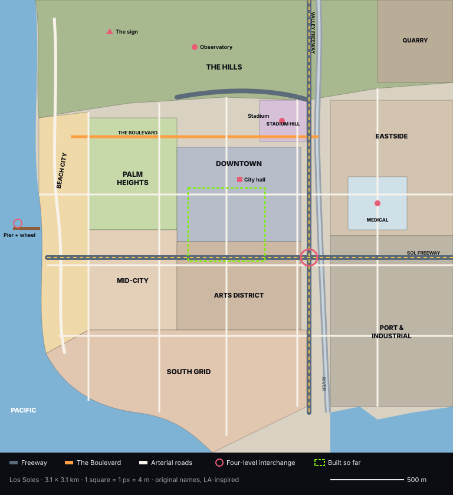

# Los Soles city plan (Phase 2, draft for the owner)

The whole city is a 3.1 km square (`WORLD_HALF` = 1,536 m), LA-inspired with original names (D-19). The downtown block built in Phase 0 (dashed green) stays where it is: its plaza is the city's origin.

| District              | Inspired by                    | What it is in the game                                                                                |
| --------------------- | ------------------------------ | ----------------------------------------------------------------------------------------------------- |
| **Downtown**          | Downtown LA                    | Glass towers, city hall, the spawn plaza, banks and offices; the current prototype block              |
| **The Boulevard**     | Hollywood / Sunset Boulevard   | One long east–west avenue of shops, clubs, neon and palm medians; the nightlife strip                 |
| **The Hills**         | Hollywood Hills, Griffith Park | Winding roads, villas, the big hillside sign (original text) and the observatory overlooking the city |
| **Beach City**        | Santa Monica, Venice           | Beachfront, the coast road, the pier with its Ferris wheel, skate park and boardwalk                  |
| **Palm Heights**      | Beverly Hills                  | Wide palm-lined streets, mansions, luxury stores and the car dealership                               |
| **Mid-City**          | Mid-Wilshire                   | Mixed apartments and shops between the beach and downtown                                             |
| **Arts District**     | LA Arts District               | Brick lofts, warehouses turned studios, murals, the first jobs                                        |
| **South Grid**        | South LA                       | Dense grid of houses, corner stores, parks; home turf for gangs (Phase 9)                             |
| **Eastside**          | Boyle Heights, East LA         | Residential hills east of the river, markets, the medical campus (hospital respawn, Phase 8)          |
| **Port & Industrial** | Port of LA / Long Beach        | Docks, cranes, containers, rail yard; trucking and dock jobs                                          |
| **Quarry**            | foothill quarries              | A gravel pit and haul roads in the north-east foothills                                               |
| **River**             | LA River                       | The concrete flood channel from the hills to the harbour: chases and car meets                        |
| **Stadium Hill**      | Chavez Ravine                  | The stadium on its hill north of downtown                                                             |

**Roads.**

- **Sol Freeway** runs east–west, on the line of the prototype's elevated freeway (z = 212 m).
- **Valley Freeway** runs north–south along the river.
- The two meet at a **four-level interchange** east of downtown.
- A third freeway curves along the foot of the hills.
- Surface arterials run about every 480 m, with local streets between them.
- **The Coast Road** follows the beach.

**Build order.** Roads and terrain (coast, hills, river), then a greybox of the whole city, then timed drive-throughs to confirm the size feels right, then streaming, then each district's art pass.
